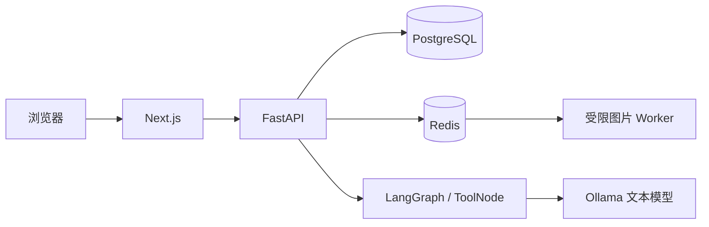

# Wardrowbe Agent

基于真实衣橱数据的 AI 穿搭 Agent，支持个人衣物管理、受控查询及基础穿搭预览。

在 [Wardrowbe](https://github.com/Anyesh/wardrowbe) 基础上扩展，保留原 MIT 许可与版权说明。本仓库是增量实现的源码快照，包含后端、前端、测试和交付文档。

## 核心功能

- 个人衣物管理、分类、颜色和标签编辑、归档与恢复。
- 单张图片上传、三种尺寸签名访问、受限图片旋转任务。
- LangGraph 编译工作流，ToolNode 顺序执行绑定用户和 Session 的衣橱查询，校验 ToolMessage 关联。
- 基于已核验候选组合上衣与下装，最多三套不同方案。模型负责生成文案。
- 本地 CPU 与 SSH 隧道远程 GPU 两种 Ollama 接入模式，保留认证、权限、资源和请求审计。

## 架构

## 验收范围

历史部署已完成真实衣物 CRUD、图片旋转和穿搭预览闭环。一次新版穿搭请求耗时 3.51 秒，调用模型一次，三项文案未回退。该请求的 GPU 证明为 unknown；另一次历史请求取得指定 GPU 的完整证明。单次结果不代表并发或生产 SLA。

隔离测试覆盖用户隔离、标签与归档、图片失败补偿；旋转 Worker 的隔离负载观察为 30 分钟、30 成功、0 失败。历史报告保留分批测试结果，避免重复计数。

批量操作、视觉 AI、去背景、自动保存穿搭和正式任意用户注册未开放。真实部署曾因内存保护暂停推理，Worker 当前状态需在实际运行环境确认。

## 技术栈

Python 3.11、FastAPI、Pydantic、SQLAlchemy、PostgreSQL、Redis、ARQ、LangGraph、httpx、Ollama、Qwen3、Next.js、TypeScript、NextAuth、TanStack Query、next-intl。

## 运行与开发

本发布副本使用示例服务器、目录和 GPU UUID。先阅读 [发布说明](docs/PUBLICATION_NOTES.md) 与 [部署文档](docs/DEPLOYMENT.md)，再准备依赖和自己的可信配置。私有启动保护包、凭据、模型权重和构建产物不在仓库内，不能直接依赖原电脑的配置启动。

新环境依赖准备参考 [开发指南](CONTRIBUTING.md#local-development)。写入测试使用独立 PostgreSQL、Redis 和临时图片目录，并显式设置 TEST_DATABASE_URL、TEST_REDIS_URL。模型测试通过 Mock 或另行获准的本地推理进行。

## 项目文档

| 文档 | 内容 |
|---|---|
| [系统架构](docs/ARCHITECTURE.md) | 组件、数据边界及核心技术实现 |
| [Agent 流程](docs/AGENT_WORKFLOW.md) | LangGraph、ToolNode、ToolMessage 与输出校验 |
| [部署指南](docs/DEPLOYMENT.md) | 双模式、SSH、启动停止和回滚 |
| [最终验收](docs/FINAL_PROJECT_REPORT.md) | 真实、隔离与 Mock 证据及遗留问题 |
| [演示指南](docs/DEMO_GUIDE.md) | 3–5 分钟演示流程 |

目录中 backend/app 为后端，backend/scripts 为运维入口，backend/tests 为测试；frontend/app、components、lib、messages、tests 分别为页面、组件、契约、国际化与测试。

## 许可与来源

原项目 [Anyesh/wardrowbe](https://github.com/Anyesh/wardrowbe)，许可见 [LICENSE](LICENSE)。本项目保留上游源码及声明，新增 Agent、受控权限、前端交互和工程验收。
