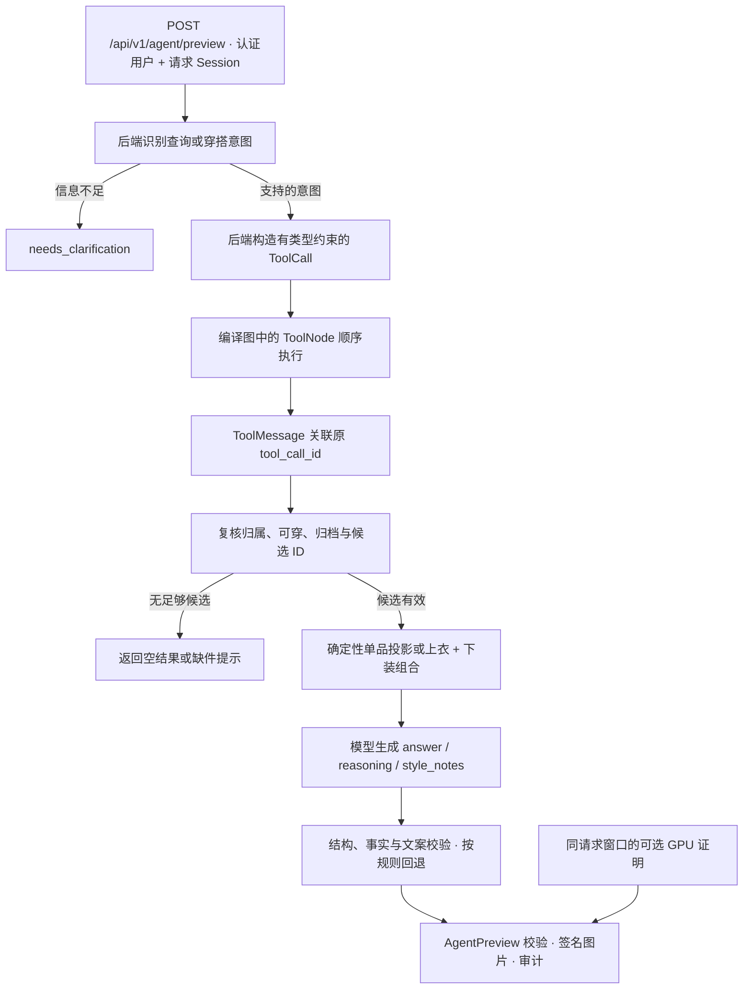

# Agent 与 LangGraph 执行流程

- **工具与身份。** 工具由后端绑定用户和 Session。模型适配器支持 Tool Calls 与 ToolMessage 协议，正式衣橱工作流对明确查询使用后端构造的调用。顺序执行避免在同一 AsyncSession 上并发查询。
- **可信组合。** 只选本次查询返回且经复核的候选。基础穿搭至少包含上衣和下装，可选鞋子和外套，最多三套不同方案。单品查询单独展示。名称、类型、ID、图片及业务状态由后端生成。
- **模型与文案。** 模型生成结论、用户可读理由和穿搭提示。内容受已记录衣物事实约束。截断、非法结构或伪造字段拒绝，低质量文案按原规则安全回退。审计记录回退字段、原因、规则和长度。
- **执行语义。** 图内决策或工具节点次数与真实模型 HTTP 次数分开统计。新版真实成功请求是一次 ToolNode 与一次模型 HTTP 调用。预览本身不保存穿搭。
- **GPU 证明。** SSH 连接、服务就绪、模型加载和物理 GPU 执行是不同状态。只有同一请求窗口中关联到模型摘要、runner PID/启动时间、指定 UUID、完整层加载和显存采样的证据才可标记已验证。缺失或过期显示 `unknown`。

代码入口见 [Agent API](../backend/app/api/agent.py)、[查询控制器](../backend/app/services/wardrobe_query_agent.py)、[工具](../backend/app/agent_tools.py)、[组合引擎](../backend/app/services/outfit_engine.py) 和 [请求审计](../backend/app/services/agent_audit.py)。
