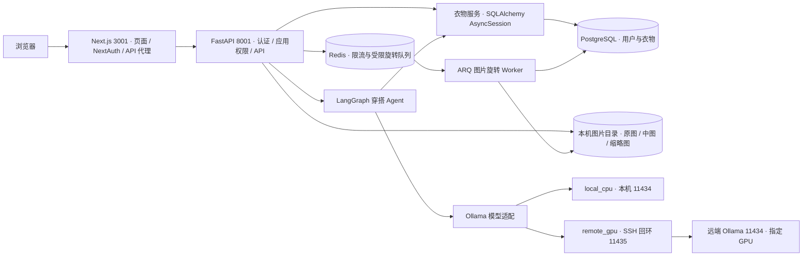

# Wardrowbe 系统架构与核心实现

## 数据与权限

| 边界 | 实现 |
|---|---|
| 模式选择 | 受信启动环境选择 `read_only_demo` 或 `full_app`。能力 API 驱动 UI，未知状态收紧操作。 |
| 四层保护 | 启动管理器核验策略包摘要，Next.js 代理与 FastAPI 中间件限制方法和路径，SQL 保护核验 Session、操作和 ORM 对象归属。 |
| 用户范围 | 账号从认证上下文取得。衣物接口和 Agent 工具复用请求 Session 和用户范围查询。客户端和模型均不能注入用户 ID。 |
| 图片访问 | 上传生成三个尺寸，响应使用签名访问地址。有效签名 URL 是短期持有者凭据，分享有效链接会分享该时段的访问能力。签名内容不进入审计。 |
| 文件补偿 | 上传失败或数据库提交失败清理本次生成的文件。删除先完成数据库事务再清理对应文件。有保护关联或图片处理中时可拒绝删除。 |
| 后台任务 | Redis DB15 用于已授权的短期限流和受限旋转队列。仅允许签发、校验后的旋转任务，单并发、一次尝试。入队失败恢复状态，Worker 拒绝过期或重放任务。 |
| 错误处理 | 区分存活与数据库就绪。认证、上传等敏感入口在 Redis 限流故障时安全失败。图片加载失败使用占位，API 日志对凭据和签名参数脱敏。 |

入口代码可从 [权限清单](../backend/app/access_policy.py)、[SQL 保护](../backend/app/write_guard.py)、[图片事务](../backend/app/services/image_transactions.py) 和 [旋转 Worker](../backend/app/workers/authorized_rotation.py) 阅读。现行开放范围见 [验收报告](FINAL_PROJECT_REPORT.md)。
